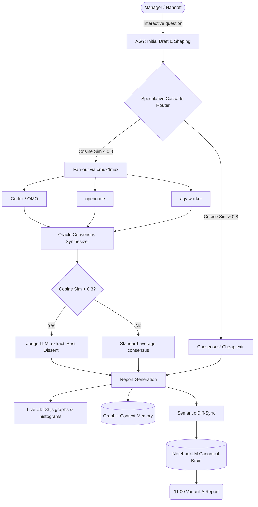

# [L179·R869] 🔮 IDR-V2 / Oracle Vision — Consolidated Plan

> 🧠 NotebookLM: [canonical notebook](https://notebooklm.google.com/notebook/270598c3-713d-4188-81b8-0f0567c71572)
>
> **Faithful consolidation, 2026-06-23.** Merges the earlier IDR-V2 / Oracle Vision planning docs into one report. Nothing invented — every section cites its source doc. This is a **planning artifact**, not runtime proof: per the source QG note, runtime stays 🟡 until `oracle_router`, Judge/Fan-out, Anti-QG JSON and delta-sync are implemented and driven through real proofs.

---

## 📚 Source Docs

| Doc | Role | Path |
|---|---|---|
| `L179-IDRV2-ORACLE-VISION-PLAN-2026-06-18.md` | Main plan: vision, verified state, top-5 architecture, harness roles | `/Users/mh/agent-mon/reports/` |
| `ORACLE-V2-PROPOSAL.md` | Why / What-Changes: skill `idr-oracle-v2`, harness auto-discovery, council fan-out, capability list | `/Users/mh/agent-mon/reports/` |
| `L179-IDRV2-OPENSPEC-QG-AGY-2026-06-18.md` | OpenSpec scope, task graph, quality gates, risk table, architecture flow (Mermaid) | `/Users/mh/agent-mon/reports/` |
| `IDR-10X-L176-L183-LAUNCHPAD-2026-06-18.md` | 10x-IDR lenses, no-fake-green rule, L179 honest status + diagram | `/Users/mh/agent-mon/reports/` |
| `IDR-QA-VERDICTS-V2.md` | QA verdicts Pass-2 with proofs (file:line) over the whole IDR corpus | `/Users/mh/agent-mon/reports/` |
| `IDR-V2-VERIFY.md`, `IDR-V2-20-IDEAS.md`, `IDR-ORCHESTRATION-ARCH.md` | Referenced by ID in the plan but **not found as standalone files** — see "Header/Registry Mismatch" | n/a (referenced only) |

---

## 1. 🔮 Vision (plain terms)

> Source: `L179-IDRV2-ORACLE-VISION-PLAN-2026-06-18.md` §2 · `ORACLE-V2-PROPOSAL.md` (Why) · `L179-IDRV2-OPENSPEC-QG-AGY-2026-06-18.md` §1

IDR-V2 shifts research from a **single-engine** perspective to a **multi-model consensus system** — an "Oracle / Council" instead of trusting one model and inheriting its blind spots.

Flow in one breath:
1. A question is **refined interactively on the cheapest local harness** (e.g. `agy`), human-in-the-loop via the `askq` bridge.
2. Once finalized, it is **fanned out in parallel to ALL discovered local harnesses** (`agy`, `codex`, `omo`, `opencode`).
3. The **Oracle synthesizes** the answers — finds consensus AND preserves valuable dissenting opinions instead of averaging them away.
4. Everything is orchestrated transparently in a **`cmux`/`tmux` superagent session** with a live drill-down UI, and smart-saved both locally and to NotebookLM (the canonical brain).

**Why it matters for the manager handoff:** the 11:00 Variant-A report is no longer one engine's half-answer but an objectified, multi-perspective consensus with traceable `.proof` artifacts. `idr-oracle-v2` is a **new, additive skill** that *extends* `integrative-deep-research` (reuses its NotebookLM-canonical / no-duplicate discipline and report style) — it does not replace it.

---

## 2. 🏗️ Architecture + Harness Roles

> Source: `L179-IDRV2-ORACLE-VISION-PLAN-2026-06-18.md` §6 · `L179-IDRV2-OPENSPEC-QG-AGY-2026-06-18.md` §3

| Harness | Role | Responsibility |
|---|---|---|
| 🦀 **Claude Code (CC)** | **Planner** | Analyzes tasks, writes the OpenSpec, creates implementation plans, watches high-level progress. |
| 🟣 **Codex (omo / lazycodex)** | **Main Orchestrator** | Reads CC's plans, drives the VCVM Control-Plane via `tmux` multiplexing, does backend Python wiring, orchestrates the fan-out. |
| 🟦 **agy (Antigravity)** | **UI Builder & Cheap Worker** | Builds the frontend (HTML/JS/CSS), serves as the interactive question-shaping interface, runs Speculative-Cascade first passes + routine tasks. |
| **opencode / omo** | **Execution Workers** | Run sub-tasks in parallel lanes, generate code, run live routines, produce `.proof` artifacts. |
| **Graphiti / Memory** | **Context Memory** | Stores the context history, prevents "forgotten lines", preserves state across sessions. |
| 🧠 **NotebookLM** | **Canonical Brain** | Receives only distilled, synthesized Oracle/manager outputs via **Semantic Diff-Sync** (deltas only, no duplication) — single source of truth for humans. |

### Architecture Flow (from the OpenSpec-QG doc)

### Engine-split build constraint

> Source: `ORACLE-V2-PROPOSAL.md` (Impact / `engine-split-build`)

agy builds the UI, Codex implements/wires, and the orchestrating CC lane **only spawns/briefs lanes** — RAM-safe, no Claude sub-agents under swap pressure. OSS-only, Opus 4.8 (no Fable 5), no `git push` without approval, team-cap respected.

---

## 3. ✅ What Was Already Verified — the 17 Criteria

> Source: `L179-IDRV2-ORACLE-VISION-PLAN-2026-06-18.md` §3 (citing the `IDR-V2-VERIFY.md` deep audit) · capability IDs from `ORACLE-V2-PROPOSAL.md` (Capabilities)
>
> ⚠️ Caveat: the plan states these were "fully implemented, verified, backed by live screenshots." The later QG note in `L179-IDRV2-OPENSPEC-QG-AGY-2026-06-18.md` marks runtime as 🟡 (planning artifact, not a fresh runtime validation). Reproduced faithfully — the conflict is itself an open point (see §5).

The numbers in parentheses are the capability indices referenced in the proposal's `oracle-ui-dashboard` / `live-smart-save` / `auto-start-config` / `provider-budget-status` / `omo-continuous-proof` capabilities.

| # | Verified criterion | Group |
|---|---|---|
| 1 | Harness Auto-Discovery (scan PATH/configs, normalized list) | Discovery & Config |
| 2 | Init-Config routes initial drafting to the cheapest harness | Discovery & Config |
| 3 | Oracle/Council Fan-out — parallel dispatch to multiple harnesses | Fan-out |
| 4 | cmux Superagent (tmux fallback) drives the parallel run | Fan-out |
| 5 | Interactive question refinement on the cheap harness (askq bridge) | Fan-out |
| 6 | RAM-safe concurrency during fan-out | Fan-out |
| 7 | Consensus graph diagram (Mermaid) harness → Oracle convergence | UI & Viz |
| 8 | Interactive UI with reasoning tracing | UI & Viz |
| 9 | Per-harness Drill-down / traceability | UI & Viz |
| 10 | Live smart-save (run dir + cross-run knowledge graph, surfaced in UI) | UI & Viz |
| 11 | Mouse-wheel zoom + full-text slider | UI & Viz |
| 12 | Orientation-switchable Histogram generation | UI & Viz |
| 13 | Filters on all views | UI & Viz |
| 14 | Auto-start config (scan harnesses+models, load skills via agy, run Oracle) | Auto-start |
| 15 | Provider budget status — CodexBar-style weekly-limit panel + `--block` for CC | Proof & Limits |
| 16 | Manual history browser | UI & Viz |
| 17 | omo continuous-proof — live E2E via omo (lazy codex), no hallucination (R040) | Proof & Limits |
| + | NotebookLM canonical sync — non-duplicate delta updates | NotebookLM |

---

## 4. 🔬 Research Directions / Top Ideas

> Source: `L179-IDRV2-ORACLE-VISION-PLAN-2026-06-18.md` §5 (Top-5) · `L179-IDRV2-OPENSPEC-QG-AGY-2026-06-18.md` §4 task graph + §5 gates

| Idea | What | Why |
|---|---|---|
| ⚡ **Speculative Cascade** | Tiered routing: ask 2 cheap LLMs first; only fan-out to expensive models if they disagree (cosine sim < 0.8). | Drastically saves tokens — easy queries exit cheaply via agy, expensive models only fire on real disagreement. |
| ⚖️ **Debate-Mode** | Auto-trigger a "Judge" LLM when cosine similarity between answers drops below 0.3. | Resolves genuine model conflict with a reasoned verdict instead of a blind average. |
| 🗣️ **Dissent Preservation** | Oracle preserves radical-but-logically-sound outlier answers in a dedicated report section. | Stops the council from averaging away brilliant minority insights ("Model Disagreement Collapse" risk). |
| 🎭 **Persona-Jittering** | Inject slight persona variations into the fan-out system prompts. | Maximizes diversity of perspectives, widening genuine coverage of the question. |
| 📈 **Interactive D3-Graphs** | Replace static Mermaid consensus charts with scalable D3.js force-directed graphs. | Scalable, zoomable, interactive consensus visualization in the live UI. |
| 🛡️ **Structured Anti-QG** | QG must emit strict JSON/Pydantic that proves an anti-pattern does **not** exist, citing exact line/hash — no casual green checkmark. | Eliminates lazy "yes" checks and fake-green; makes proof falsifiable. |

---

## 5. 🔜 Open Points / Not-Yet-Built

> Source: `L179-IDRV2-ORACLE-VISION-PLAN-2026-06-18.md` §4 + §7 · `L179-IDRV2-OPENSPEC-QG-AGY-2026-06-18.md` §5 + §8 · `IDR-10X-L176-L183-LAUNCHPAD-2026-06-18.md` (L179 row)

### Runtime gaps (🟡 not green)

| Item | Status | Note |
|---|---|---|
| `oracle_router` / Speculative Cascade tiered routing | 🟡 stub planned | Real cosine-similarity routing in `oracle.py` not wired; only mock/dummy planned as a safe pre-11:00 task. |
| Judge / Fan-out (Debate-Mode) | 🟡 missing | cmux/tmux fan-out + Judge-LLM at sim < 0.3 not driven through real `.proof`. |
| Structured Anti-QG (Pydantic JSON) | 🟡 missing | Still markdown checkmarks; needs strict JSON proving anti-pattern absence via code-line hash. |
| Semantic Delta-Sync to NotebookLM | 🟡 missing | Diff-sync pipeline (deltas only, dedup blocker) not yet built. |
| Unit/Integration tests | 🟡 missing | No suite for `oracle.py` Judge logic + cosine-similarity calc. |
| R040 proof for Debate-Mode fan-out | 🟡 missing | No real `.proof` log-dump of the cmux fan-out. |
| D3.js force-directed UI | 🟡 scaffold | Replaces old Mermaid viewer; only placeholder scaffold planned. |
| cmux binary on VCVM | ⚠️ **missing** | Spec MUST keep a tmux-native fallback so the skill still functions (per proposal). |

### Already-green guardrails

| Item | Status |
|---|---|
| Cost/Quota Guard — weekly-limit check + free-tier fallback | 🟢 implemented |
| Handoff Regression Gate — reports without `[Lxx·Rxxx]` header + NotebookLM link are rejected | 🟢 implemented |

### Header / Registry Mismatch (to fix)

> Source: `L179-IDRV2-ORACLE-VISION-PLAN-2026-06-18.md` §4

A widespread mismatch exists in reporting headers / registry IDs across the IDR docs:
- `IDR-V2-VERIFY.md` → `[L12·R040]`
- `IDR-V2-20-IDEAS.md` → `[L91·R440]`
- `ORACLE-V2-PROPOSAL.md` → `[L44·R926]`
- `IDR-ORCHESTRATION-ARCH.md` → `[L01·R002]`

This Lane/Run-ID drift fragments the registry mapping and produces orphan entries. **Fix:** synchronize all new and retroactively relevant IDR reports to their canonical Lane/Run context (here `[L179·R869]`) so the agent-mon ledger aggregates them cleanly. *(Note: the three `IDR-V2-VERIFY` / `IDR-V2-20-IDEAS` / `IDR-ORCHESTRATION-ARCH` docs are referenced by ID but were not found as standalone files in `agent-mon/reports/`.)*

### 10x-IDR Lenses + No-Fake-Green Rule

> Source: `IDR-10X-L176-L183-LAUNCHPAD-2026-06-18.md`

Every line (incl. L179) is checked against **10 IDR lenses** before being called done. **Rule: no fake-green** — a report/plan does NOT count as runtime proof; green requires an R040/QG proof.

| # | Lens | Question |
|---|---|---|
| 1 | 🔎 Current Code | Which repo/code path really exists? |
| 2 | 📚 Existing Reports | Which IDRs/QGs already exist? |
| 3 | 🌍 Market/OSS | Which GitHub/docs/community base exists? |
| 4 | 🧩 Architecture | How does the data flow really work? |
| 5 | 🔐 Privacy/Safety | Which raw data must never go public? |
| 6 | 🧪 Quality Gate | What is the hard proof of "works"? |
| 7 | 🟢 Proven | What is already R040-green? |
| 8 | 🟡 Gap | What is only planned/yellow/blocked? |
| 9 | 🛠️ Next Worker | What should the next agent concretely do? |
| 10 | 📎 Links | Which reports/repos are directly clickable? |

In the launchpad, **L179 was prioritized P2** ("important, but runtime can come after P0/P1") — honest status: *vision/plan exists; runtime harness/Judge/fanout/delta-sync not green.*

### Risk table (carried from the OpenSpec-QG doc)

| Risk | Impact | Guardrail |
|---|---|---|
| Over-Research | Endless loops delay the handoff | Heartbeat-Operator ticket + hard timeout/depth limit |
| Duplicate Notebooks | Loss of single source of truth | Strict semantic diff-sync, canonical `manifest.json` patches only |
| Forgotten Lines | Features silently overwritten | Graphiti memory tracing + Structured Anti-QG Pydantic model |
| Quota Burn | Expensive models eat the budget | Speculative Cascade catches easy queries via agy + limit-hook guard |
| Fake Proofs | Hallucinated ✅ deceive the manager | R040 proof requirement; cmux generates irrefutable stdout artifacts |
| PII Leak | User data into prompt / NotebookLM | Pre-fanout sanitizer (regex creds + PII) |
| Model Disagreement Collapse | Oracle averages away brilliant insights | Judge-Mode + Dissent Preservation |

---

## 6. 🛠️ Next Worker Brief (as planned)

> Source: `L179-IDRV2-ORACLE-VISION-PLAN-2026-06-18.md` §7 · `L179-IDRV2-OPENSPEC-QG-AGY-2026-06-18.md` §8

**Target:** Codex (Orchestrator) + agy (Worker).

1. **Speculative Cascade** — integrate tiered routing into `oracle.py` fan-out: query the two cheapest harnesses first; high cosine similarity → bypass the rest; else full fan-out.
2. **Debate-Mode & Dissent Preservation** — add cosine-similarity check (< 0.3) in the consensus aggregator to trigger a Judge-LLM, and explicitly extract the "Best Dissent" for the final report.
3. **Structured Anti-QG** — update QA gate to require JSON-structured proofs against specific anti-patterns; no lazy "yes" checks.
4. **Constraints** — no new mocks in the proof run, all code inside the established cmux/tmux VCVM architecture orchestrated by Codex, output must include valid `.proof` artifacts.

**Safe pre-11:00 task (no Codex quota):** build `oracle_router.py` with mocked cosine-similarity (dummy answers), scaffold the D3.js force-directed graph as a placeholder (replacing the old Mermaid viewer), and define the JSON schema for the Structured Anti-QG Pydantic model. Codex then plugs in the real orchestration fan-out afterward.

---

## 7. 🧪 QA Corpus State (context)

> Source: `IDR-QA-VERDICTS-V2.md` (Pass-2, file:line proofs)

The QA verdicts doc scores the whole IDR corpus against the IDR Reporting Standard (Variant-A header, NotebookLM subtitle, GitHub-link+stars matrix head, 100-point scoring, 👑 winner, embedded screenshots). Most legacy IDRs score 🔴 30–55 or 🟠 60–75 — common defects: missing 100-point matrix, missing GitHub links/stars, missing NotebookLM subtitle, missing Variant-A tag. **One doc scored 100/100 🟢: `GRAPHITI-AUTOSTORE-IDR.md`.** This is the formatting-compliance backdrop the IDR-V2 reporting standard (top of this doc) is meant to enforce going forward.

---

## 📎 Sources Recap

- `L179-IDRV2-ORACLE-VISION-PLAN-2026-06-18.md` — vision, 17 verified criteria, top-5 ideas, harness roles, header-mismatch fix, next-worker brief.
- `L179-IDRV2-OPENSPEC-QG-AGY-2026-06-18.md` — OpenSpec scope/invariants, task graph (phases 0–2), quality gates, Mermaid flow, risk table, safe pre-11:00 task.
- `ORACLE-V2-PROPOSAL.md` — Why/What-Changes, `idr-oracle-v2` skill, capability list, engine-split-build, impact/constraints.
- `IDR-10X-L176-L183-LAUNCHPAD-2026-06-18.md` — 10x-IDR lenses, no-fake-green rule, L179 honest status (P2), Mermaid diagram.
- `IDR-QA-VERDICTS-V2.md` — Pass-2 QA verdicts with file:line proofs over the IDR corpus.
- Referenced-but-not-found: `IDR-V2-VERIFY.md`, `IDR-V2-20-IDEAS.md`, `IDR-ORCHESTRATION-ARCH.md` (cited by ID only).
